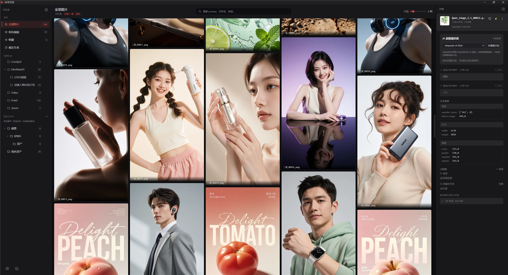

# 闪寻空间 (Seek-X)



**闪寻空间 (Seek-X)** 是面向 ComfyUI 用户的**本地图片、视频、音频与文本管理器**。它会自动扫描你配置的目录，把 AI 生成的成品按文件夹/时间整理成瀑布流，并支持反推提示词、标签、全文搜索，以及本地视频播放、对比与音频波形播放。

> 由「苏醒图库」更名而来，界面、数据目录与更新通道保持不变。

---

## ✨ 核心能力

### 图片 & 视频统一管理
- 三栏布局：左侧文件夹树 / 中间瀑布流缩略图 / 右侧详情面板
- 默认落在**所有素材**：图片、视频、音频、文本按时间混排在一条无限滚动的流里，用类型 chips 单选过滤（默认「全部」，点某类只看那类）
- 图片：PNG / WebP / JPG / PSD 等，自动解析常见元数据（A1111 / ComfyUI tEXt）；PSD 缩略图按 9:16 裁切铺满，预览显示合成画面，右键可在 Photoshop 中打开
- 视频：MP4 / MOV / M4V / WebM / MKV / AVI / WMV / FLV，自动生成**海报帧缩略图**（按静态图的 WebP 质量出图，不再糊成一块），**鼠标悬停就地预览**（只有悬停那一张真的在解码）、**双击打开内置播放器**（内核解不了的容器转系统播放器），支持**左右对比（默认）/ 分割对比**（开关和图片一样在顶栏正中，`S` 反复切换），对比时右键画面可**同步播放 / 同步停止 / 取消同步**，可**一键改封面**
- 音频：MP3 / WAV / FLAC / M4A / AAC / OPUS / OGG 与图片视频同等入库（单文件上限 200MB，够放 24bit FLAC 母带），21:9 的**频谱波形缩略图**（后端那张真振幅波形图当蒙版，配色与发光全站一套），**卡面上不放播放键**——**整张卡就是播放控件，点一下就地播放、再点暂停**（进度轨常驻在波形下面，双击卡片同样能播，右键菜单里另有播放/暂停）、右键**复制音频**是把文件本身放进剪贴板（可直接粘进文件夹）；内核解不了的容器一键转系统播放器
- 缩略图生成与磁盘缓存，滚动流畅
- 卡片全站一套规范：画面在上、不透明信息条在下（文件名带扩展名 + 尺寸 / 大小 / 时长），常态无框、**hover 只放大画面不描边**、只有选中才描边；卡片变窄时信息条自动降成单行、再窄（<120px）整条隐藏只留画面
- 瀑布流工具栏自适应：宽列时搜索框落在工具栏正中间（全圆角 pill，点进去提示文字自动隐去，失焦回来）；详情面板展开、窗口变窄时类型 chips 与列数滑块整组贴右并自动换行，**不会被面板裁掉**，也不会被拉开成大空档
- 全局快捷键：<code>Ctrl+F</code> 光标直接进搜索框（原有内容整段选中，接着打字即替换）、<code>F</code> 沉浸循环（收起左右侧栏 → 最大化 → **全屏只剩缩略图**（标题栏、两条侧栏、搜索工具栏全部退场）→ 还原窗口与原侧栏，再按从头再来）、对比中 <code>S</code> 在左右与分割之间反复切换（图片和视频同一个开关、同一份偏好）。这几条连同侧栏 / 复制 Prompt 都能在「设置 → 快捷键」里改键

### 本地文本管理
- 支持 TXT / Markdown / SRT / VTT，关联原文件或目录，编辑直接保存到原文件
- 多文档标签页、Markdown 阅读与编辑、中文正文搜索、标签
- 自动保存、外部修改冲突提示、本地草稿和历史版本；删除进入系统回收站
- 双击文件名改名、长按拖动排序；拖动列表右侧分隔线调整宽度
- 侧栏一行一个口径，快捷键 <code>Q</code> 或 <code>0</code> 回所有素材，<code>A / I / V / T</code> 切音频、图片、视频、文本（输入时不触发；这五个键不给自定义快捷键占用）

### 反推提示词
- 内置 **OpenAI 兼容**的几家 API 预设（含 DeepSeek），各预设提供多个模型下拉
- 输入 API Key 保存即可使用；也保留**手动自定义**入口
- 支持简单 / 详细两档提示词输出

### 一键同款（拿这张素材当初的配方再抽一张 / 再出一条）
- **图片、视频、音频三类卡片**页脚右下角**同一枚**「一键同款」角标（同一套位置与尺寸，不给音频另造一套入口）→ 弹窗左边是这张素材（**视频就地能播**、**音频是波形 + 一条播放器**，不用跳出去看），右边是**可以直接改的配方**：参考位、完整提示词、比例、时长与分辨率（时长是 **3–15 秒的滑块**，旁边可以直接敲数字），改完点生成
- **视频同款不换界面，只换工作流**：同一颗图标、同一个弹窗，参考位分成**图片 / 音频 / 视频三族**（H3 参考生视频这份工作流吃得下 9 图 + 3 音频 + 3 视频），三族排在**同一行**（图片 → 视频 → 音频，和 H3 把参考摆进上下文的次序一致），只画已填的格子，末尾**一颗不绑族的「+ 参考」**——点它先在弹窗里挑族（图片 / 视频 / 音频 三个 tab），选到哪族就落那一族第一个空位；从视频卡打开时这条视频先站进「视频1」，从图片卡打开仍进「图片1」
- **挑素材的弹窗自己就能验货**：视频 tab 里鼠标滑过缩略图就地播（静音循环，只解码滑过那一条，与图库卡片同一个 `hoverPlay`）；音频 tab 每张卡的试听角标与文件名**同一行、同一条中线**（22px 圆标钉在最右，长文件名照旧省略号），点一下试听、再点停，点角标不会顺手把它选进参考位；换族或关弹窗都会把这里起的试听收掉，不让人带着一段不知道哪儿在响的音频回到图库
- **参考位认得出几张就摆几张**：当初喂两张就显示图片1 / 图片2，每张可换、可删、可继续加（上限看工作流本身，多图编辑类最多 16 张）；提示词自动带上这张素材自己那句，输入 `@` 直接点名参考图——图片工作流插 `@图片N`，视频工作流插 H3 原生标签 `<Picture 1>` / `<Audio 2>` / `<Video 1>`（音频编号已扣掉参考视频自带的音轨，不会指错人）
- **来源不是猜的**：成图 PNG 里的 ComfyUI 工作流带着当初上传的 `seekx_ref_<图库id>_<内容hash>` 文件名，所以哪怕那条记录没写进库、或者换了机器重扫（id 全变），也能按内容 hash 把原图认回来；认不出就直说「没找到当初用的参考图，先放了它自己当参考」，**绝不拿成图冒充参考图**（视频产物不是 PNG，读不了 tEXt，只走库记录）
- **开箱自带五条工作流**：安装包内置「**闪寻图片**」（Qwen image 多图编辑，最多吃 16 张图）、「**闪寻视频**」（MiniMax H3，9 图 + 3 音频 + 3 视频）与出声音的三条——「**闪寻参考音色**」（Qwen3-TTS 音色克隆，吃 1 段参考音频）、「**闪寻音色描述**」（用一段话说明要什么样的声音）、「**闪寻指定音色**」（从 9 个现成人物音色里挑一个，可另写语气），第一次打开就在设置 → 一键同款 里，图片 / 视频 / 音频三族各有各的「当前」。参考位与参数槽是**随包带进来的**（在真机 ComfyUI 上检测准了才打进包），所以首启不要求 ComfyUI 在线也摆得出完整弹窗；行首多一枚「内置」徽标，自己改过名或改过正文的那条不会被版本更新覆盖，删掉也不会下次启动又长回来
- 工作流来自 **设置 → 一键同款**：导入 ComfyUI 导出的 **API 格式** JSON（UI 格式会被拒绝并告诉你该导出哪种），可以存好几份；弹窗底部那颗工作流按钮随时切换（每条**名字前面**钉一枚「图片 / 视频 / 音频」徽标，名字左对齐，一眼分得清出图、出片还是出声音；出声音的那三条在清单里**折成一行「闪寻音频」**——它们是同一件事的三种模式，模式在弹窗顶上选，清单里再列三条就是要人在两个地方选同一件事，那一行不给删除 X（删哪条不该由它临场决定，设置页里仍各占一行）、悬停那枚 X **直接删除不用再确认一遍**，本地导入的文件名自动去掉 `.json` 后缀
- **出图、出片还是出声音自动判定**（看末端产出节点是 `SaveVideo` / `VHS_VideoCombine` 还是 `SaveImage`）：图片卡、视频卡、音频卡各有各的「当前」工作流，**换卡片时工作流跟着卡片那一族走**（音频卡用完再点图片卡，不会还挂着出声音那条；同族之间保留你手动挑的那条），判错了在设置页那一行的下拉里当场改判（**出图 / 出片 / 出声音**三选一），不用重导
- **出声音的三种方式在弹窗顶上排成一排按钮**（参考音色 / 音色描述 / 指定音色）：它们是**三份不同模型的工作流**，不是一个能中途改的开关（中途换要重载模型），所以按钮换的就是工作流本身；切过去时台词原样留着，参考那一整块跟着消失（后两种根本不吃参考音频，摆个空位和一颗点了不出东西的「+ 参考」比不摆更糟），下面那句小字改成「这一种不用参考音频」；三种模式下弹窗标题与底部那颗工作流按钮**都写「闪寻音频」**，跟清单那一行同一个叫法（具体是哪一条在悬浮提示和设置页里）
- **音色克隆要两段话，弹窗就分两格**：要说的话（台词）进上面那个大框，**参考音频里说的原话**单独一格，预填工作流里那句，改台词不会把原话冲掉（混成一格克隆出来的音色立刻不像）；原话留空才退回跟着台词走。另两种的第二个框说的是各自的活儿——「音色描述」是**必填**（那格决定声音长什么样），「语气与风格」可留空（不写就按默认说话方式），三格共用一句占位语就是骗人
- **「指定音色」里那九个音色各有一张脸**：参数面板的音色格不再是九颗圆点，而是 Qwen3-TTS 自带那九个人物各自的头像（Vivian / Serena / Uncle Fu / Dylan / Eric / Ryan / Aiden / Ono Anna / Sohee），底部那颗胶囊也跟着带上当前选中的那张脸——不点开面板就知道现在用的是谁的声音。脸是照**模型给的音色描述**画的（明亮带棱角 / 温和亲切 / 低沉醇厚的长者 / 清亮的北京小伙 / 活泼略带沙哑的成都男声 / 节奏感强的男声 / 阳光美式男声 / 轻快的日语女声 / 富有情绪的韩语女声），不是照名字的词根随便配一张脸；认不出的选项（用户自己练的音色、语种、比例）一律回落到原来那颗小圆点，绝不乱配。图在 `frontend/public/voices/`，256px WebP，一张约 15KB
- **重开「同款」不用重新打字**：提示词按「产出自带的 → 当初生成时记下的 → 反推的」取。PNG 自带 tEXt、视频有元数据，**音频什么都没有**，所以台词与原话在生成当时就一并写进来源记录，下次点同款直接回到那两个框里（小字会写「已带上当初生成时用的提示词」）；你已经在框里动过手，就一句都不再自动填
- 出片出图直连本机 ComfyUI，进度实时回显（生成中不给换工作流，会写明原因），产物**就地认领**回 ComfyUI 的输出目录，不另建「一键同款」文件夹；视频给 60 分钟兜底，超时自动打断并说明原因

### 整理 & 搜索
- 文件夹树：来源目录 + 我的文件夹，支持**新建 / 重命名 / 上移 / 下移 / 所在文件夹位置 / 归档**
- **来源目录 = 导入的那个文件夹本身**：它先是一个节点，里面的子目录逐级展开在它下面；标题右边的 `+` 直接添加来源目录
- 来源目录只登记位置 + 递归监听，**不复制也不移动任何文件**；改它的名字只是图库里的显示标签，磁盘上的真实目录不动（「我的文件夹」住在图库数据目录里，改名仍同步物理目录）
- **归档 ≠ 删除**：右键「归档」只在图库里收起这个目录和它里面的素材，磁盘上的文件夹与文件一个都不动，标签也留着；恢复在 设置 → 已归档目录，侧栏会写明有几个目录被归档了。「删除文件夹（移入回收站）」只出现在**我的文件夹**上——那些目录本来就在图库数据目录里，才可以连磁盘一起删
- 标签（逗号分隔，自动去重）
- 侧栏计数只有一个口径：每行显示当前类型的数量，分组标题右侧写明「计数 · 音频」，hover 给出四类明细；一万以上折成「1.2万」
- 全文搜索（SQLite FTS5 + 模糊双轨）
- 批量多选、拖拽导入

### 桌面体验
- **自带 ffmpeg / ffprobe**：视频海报帧、音频波形、读取视频容器里的 ComfyUI 工作流不再要求用户自己装 ffmpeg（旧版在没有 ffmpeg 的电脑上海报和提示词会静默变空）
- 设置 → 媒体组件 常驻状态，直接显示 ffmpeg/ffprobe 的版本与来源，缺了会写清下一步
- 设置页：左目录按「素材库 / 操作 / AI 与集成 / 应用」四组列八项，顶部搜索框真过滤（连每项的说明关键词一起命中）；右侧一条连续滚动流，每项一张圆角卡片、一行一个设置（左标题与说明、右控件），每组右下角单独保存
- 左侧栏 & 右侧详情栏均可一键收起
- ComfyUI 一键打开（生成临时 `.json` 并跳转）
- Onboarding 引导、扫描进度、快捷键
- 签名自动更新（GitHub Releases）：设置 → 软件更新 里「自动检查更新」下面还有「自动更新」，打开后发现新版本就自动下载、校验并安装，装完自动重启（安装前先备份图库数据库，素材原文件不动）。默认关；便携版或安装位置未确认时不会自动安装
- 设置 → 关于 写明开发者（苏醒）与微信联系方式、赞赏收款码，反馈直接扫

---

## 🛠 技术栈

| 层 | 技术 |
|------|------|
| 桌面壳 | Tauri 2 (Rust) + NSIS `x64` |
| 后端 | Python FastAPI + SQLite / FTS5 |
| 前端 | Svelte 5 + Vite + Tailwind |
| 视频 / 音频处理 | `ffmpeg` / `ffprobe`（海报帧、波形图、时长与编码信息，无额外 Python 依赖；随安装包自带，不要求用户自装） |
| 平台 | Windows |

---

## 🚀 安装

从 [GitHub Releases](https://github.com/suxing105-tech/synex/releases) 下载最新版 `suxing-gallery_<版本>_x64-setup.exe` 安装即可。已装用户可通过应用内更新自动升级。

### 从源码构建

```powershell
# 0) 准备 ffmpeg / ffprobe（安装包要用，约 5s；已备好会跳过）
#    依次找 -SourceDir → vendor\media-tools\ → PATH（winget 装的即可），
#    命中后缓存进 vendor\media-tools\（已 gitignore，约 190MB）
& "frontend\scripts\fetch-media-tools.ps1"

# 1) 打包后端 sidecar（约 30s）
& "frontend\scripts\build-sidecar.ps1"

# 2) 构建 Tauri + NSIS（约 30s~5min）
cd frontend\src-tauri
cargo tauri build

# 产物
#   target\release\suxing-gallery.exe                     主程序
#   target\release\bundle\nsis\闪寻空间_<版本>_x64-setup.exe   NSIS 安装包
```

> `build-preview.ps1` / `package-release.ps1` / `build-update.ps1` 会自己先跑第 0 步，缺工具直接中止并告诉你要放哪些文件，不会再打出「装了也用不了」的包。
> 安装包里的 ffmpeg/ffprobe 来自 gyan.dev 的 GPL-3.0 构建，许可证全文随包安装为 `ffmpeg-LICENSE.txt`。
> 发布、预览包与公网校验的完整流程见 [docs/release-process.md](docs/release-process.md)；签名安装包由 `frontend\scripts\build-update.ps1` 产出（需更新签名私钥）。

### 本地开发

```powershell
# 后端
cd backend
python -m venv .venv
.\.venv\Scripts\Activate.ps1
pip install -e ".[dev]"
uvicorn app.main:app --host 127.0.0.1 --port 8765

# 前端（新终端）
cd ..\frontend
pnpm install
pnpm dev        # http://localhost:5173（代理到 8765）
```

---

## 🧪 测试

- 后端：`558 passed + 1 skipped`（parser / indexer / repository / api / video / audio / folders / text / psd / 迁移 / 发布脚本；需在 `backend\.venv` 里跑，那里才有 `psd_tools`，用系统 Python 会跳过 1 条 PSD 用例）
- 前端：`876 passed`（107 个测试文件）
- Rust：`43 passed` + 1 个集成测试（另有 1 个需真机环境的集成测试默认 ignore）
- `svelte-check`：`0 errors`

```powershell
# 一次跑完上面四套（日志与 VERIFY.txt 落在 outputs\verify-latest）
powershell -NoProfile -ExecutionPolicy Bypass -File frontend\scripts\verify-all.ps1

# 后端单独跑
cd backend && .\.venv\Scripts\python.exe -m pytest -q

# 前端单独跑
cd frontend && pnpm test -- --run
```

---

## 📁 目录结构

```
闪寻空间\
├── backend\                # FastAPI 后端
│   ├── app\                # 入口 / 解析 / 缩略图 / 索引 / 仓储 / 路由
│   └── tests\              # pytest
├── frontend\               # Svelte 5 + Vite + Tailwind
│   ├── src\                # App / 组件 / stores / api
│   ├── src-tauri\          # Rust 壳 + NSIS 配置（resources\ 放随包的 ffmpeg 许可证）
│   └── scripts\            # sidecar / 更新 / 发布 / ffmpeg 取用脚本
├── vendor\media-tools\     # 本地 ffmpeg/ffprobe 缓存（gitignore，打包时进安装包）
├── docs\images\            # README 配图
├── outputs\                # 产品 / 技术文档、构建产物
└── materials\              # 调研 / 决策记录
```

---

## 🔌 API 简表（部分）

| 方法 | 路径 | 说明 |
|------|------|------|
| GET | `/api/images?kind=&folder_id=&q=&tag=&limit=&offset=` | 单一类型列表（`kind=image|video|audio`） |
| GET | `/api/items?folder_id=&q=&tag=&kinds=&sort=&limit=&offset=` | **所有素材**统一流（四类混排 + 分类型计数） |
| GET | `/api/images/{id}` | 详情 |
| GET | `/api/images/{id}/file` | 原文件 |
| GET | `/api/videos/{id}/file` | 视频流（支持 Range 拖动） |
| GET | `/api/videos/{id}/thumb` | 海报帧 |
| GET | `/api/videos/{id}/open` | 用系统播放器打开 |
| GET | `/api/audio/{id}/file` | 音频流（支持 Range 拖动） |
| GET | `/api/audio/{id}/waveform?w=&h=` | 波形图，默认 840x360（21:9）与卡片同比例（波形只画中间一条再补透明边；懒生成 + 落盘缓存，缺 ffmpeg 时 404 由前端降级） |
| POST | `/api/audio/{id}/open` | 用系统播放器打开 |
| POST | `/api/images/{id}/tags` | 标签 |
| GET | `/api/folders` · POST · PATCH · DELETE | 文件夹管理 |
| POST | `/api/folders/{id}/move?direction=` | 上移/下移 |
| GET | `/api/health` | 健康检查 + 媒体工具诊断（`media_tools.tools.{ffmpeg,ffprobe}` 的 path/source/version） |
| GET | `/api/stats` | 统计（`total_images` / `total_videos` / `total_audio` / `total_texts` / `folders`） |
| GET | `/api/folders` | 文件夹树，节点带 `counts{image,video,audio,text}` + `total` |
| PUT | `/api/integrations/comfyui/config` | ComfyUI 配置 |
| GET | `/api/clone/templates` | 一键同款：已导入的工作流模板 + 自动检测出的提示词 / 参考位 / 参数槽 |
| POST | `/api/clone/templates` | 导入 ComfyUI API 格式工作流（UI 格式 422 并提示改导出 API 格式） |
| GET | `/api/clone/sources/{id}` | 这张成图当初用的参考图（库里记的那份优先，其次读成图自己的 workflow + hash 核对） |
| POST | `/api/clone/generate` | 用这张图的配方再生成一张（进度走 WS 的 `clone_progress`，产物就地认领） |
| WS | `/ws/events` | 实时事件 |

---

## 📝 说明

- 视频/音频处理依赖的 ffmpeg 由安装包自带；临时换版本或排障可设 `SUXING_FFMPEG_DIR`，或把 `ffmpeg.exe`/`ffprobe.exe` 放进数据目录的 `tools\` 文件夹（查找优先级：`SUXING_FFMPEG_DIR` → 可执行文件同级 → 内嵌目录 → `数据目录\tools` → `vendor\media-tools` → PATH）。
- 本仓库暂无 `LICENSE`；如需开源授权请补充。
- 自动更新使用签名安装包，更新清单见 Release 里的 `latest.json`。
- 详细设计 / 决策记录见 `outputs/`、`materials/`。
